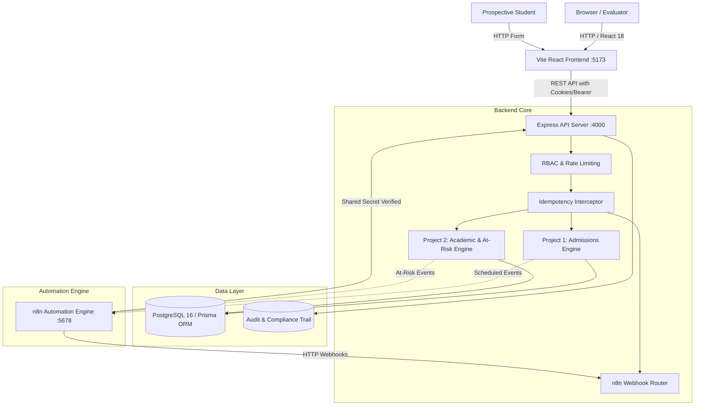
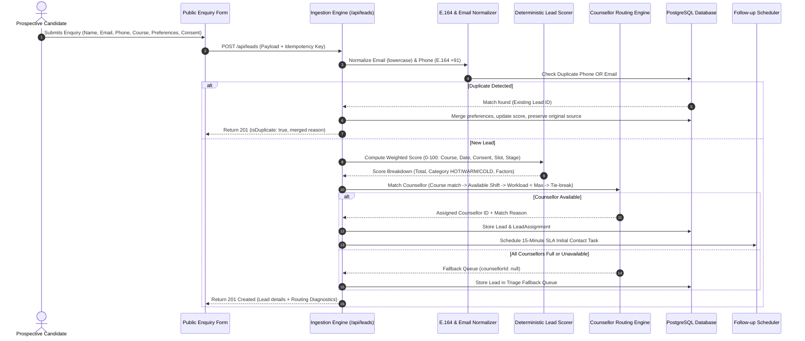
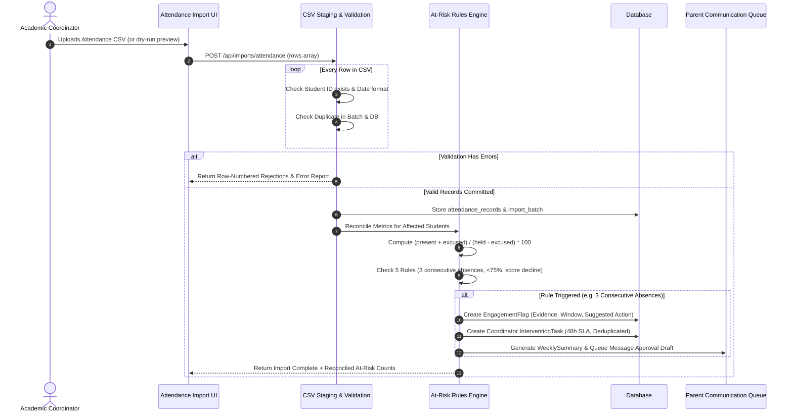

# System Architecture Specification

## 1. High-Level Architectural Blueprint
The **TEAM B Coaching Institute AI Automation Platform** is architected as a modular, event-driven monorepo separating client presentation, API services, persistent data layer, and autonomous n8n workflows.

---

## 2. Project 1: Lead Ingestion, Scoring & Counsellor Routing Engine

---

## 3. Project 2: Attendance CSV Import & At-Risk Engagement Pipeline

---

## 4. Parent Messaging Flow Safeguards
To comply with institutional privacy, student welfare, and parental communication policies, parent updates adhere to a mandatory human-in-the-loop pipeline:

1. **Deterministic Summary Generation**: Built strictly from verified attendance and assessment records. Never fabricates missing scores.
2. **Preference & Consent Gate**: Verifies guardian preferred channel (WhatsApp, SMS, Email) and checks `consentGiven === true`. If consent is false, system blocks dispatch.
3. **Quiet Hours Check**: Outreach respects configured quiet hours (default: `21:00 - 08:00 Asia/Kolkata`). Any message approved during quiet hours is queued for morning release.
4. **Authorized Staff Approval**: A human Academic Coordinator or Admin must review the preview and click "Authorize & Dispatch".
5. **Mock Delivery Adapter**: In demo mode, dispatches through a simulated mock adapter tagged **"SIMULATED"** to avoid sending live unauthorized messages to real phone numbers.
