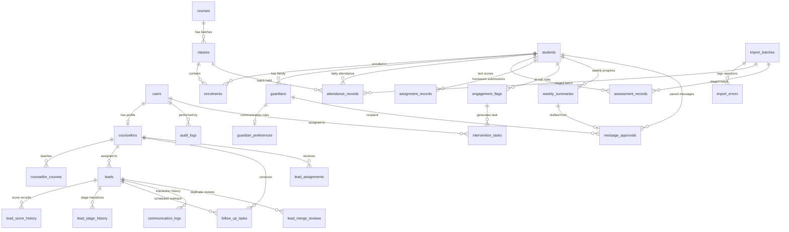

# Database Design & Schema Specification

## 1. Relational Entity-Relationship Diagram (PostgreSQL 16)



---

## 2. Table Specifications & Schema Entities

### Shared Domain
- `users`: Core authentication identity, role assignment (`ADMIN`, `ADMISSIONS_COUNSELLOR`, `ACADEMIC_COORDINATOR`, `TEACHER`), hashed credentials.
- `audit_logs`: Immutable security and data change logs (`action`, `entityType`, `entityId`, `details` JSONB, `ipAddress`, `createdAt`).
- `idempotency_records`: Webhook and API request deduplication (`idempotencyKey` UNIQUE, `endpoint`, `requestHash`, `responseStatus`, `responseBody` JSONB).
- `system_settings`: Platform business configuration (`appTimezone`, `quietHoursStart`, `slaInitialContactMinutes`, `consecutiveAbsenceLimit`).

### Admissions Domain (Project 1)
- `leads`: Candidate applications with raw and normalized fields, E.164 phone, lowercase email, score (0-100), score category (`HOT`, `WARM`, `COLD`), stage, consent, and opt-out flags.
- `counsellors`: Admissions personnel with working hours (`09:00`-`18:00`), availability toggle, and workload capacity limit (`currentWorkload` / `maxWorkload`).
- `counsellor_courses`: Mapping of courses supported per counsellor for compatibility routing.
- `follow_up_tasks`: Scheduled candidate outreach enforcing the 15-minute SLA and +1, +3, +7 day cadences.
- `communication_logs`: Simulated and dispatched SMS, WhatsApp, and phone logs.
- `lead_merge_reviews`: Audit records when duplicate enquiries are detected and merged without destroying raw attribution.

### Academic Domain (Project 2)
- `students`: Enrolled students with institutional ID numbers (`studentIdNumber` UNIQUE, e.g. `TB-2026-001`).
- `classes`: Academic batches tied to syllabus courses and teachers.
- `guardians`: Family contacts tied to students.
- `guardian_preferences`: Guardian communication consent and channel preferences (`WHATSAPP`, `SMS`, `EMAIL`).
- `attendance_records`: Daily records with unique constraint on `(studentId, classId, date)`.
- `assessment_records`: Benchmark quizzes, midterms, and finals with percentage scores.
- `import_batches`: Audit logs for CSV file uploads with valid, rejected, and duplicate row tallies.
- `import_errors`: Row-numbered validation errors with raw payload for diagnostic correction.
- `engagement_flags`: Explainable rule engine flags unique on `(studentId, rule, windowStart, windowEnd)`.
- `intervention_tasks`: Actionable coordinator tasks with 48h resolution SLA.
- `weekly_summaries`: Verified weekly student performance summaries unique on `(studentId, isoWeek)`.
- `message_approvals`: Human-gated parent outreach approval queue.

---

## 3. Sample SQL for Key Institutional Metrics

### Metric 1: Admissions Lead Conversion Rate
```sql
SELECT 
    COUNT(CASE WHEN stage = 'Enrolled' THEN 1 END) AS enrolled_leads,
    COUNT(*) AS total_enquiries,
    ROUND(
        (COUNT(CASE WHEN stage = 'Enrolled' THEN 1 END)::numeric / NULLIF(COUNT(*), 0)::numeric) * 100, 
        2
    ) AS conversion_percentage
FROM leads;
```

### Metric 2: 15-Minute Initial Contact SLA Compliance Rate
```sql
SELECT 
    COUNT(CASE WHEN completed_at <= due_at THEN 1 END) AS on_time_tasks,
    COUNT(*) AS total_completed_tasks,
    ROUND(
        (COUNT(CASE WHEN completed_at <= due_at THEN 1 END)::numeric / NULLIF(COUNT(*), 0)::numeric) * 100, 
        2
    ) AS sla_adherence_percentage
FROM follow_up_tasks
WHERE status = 'COMPLETED' AND attempt_number = 1;
```

### Metric 3: Excused-Absence Adjusted Attendance Rate
```sql
-- Formula: (present + excused) / (held - excused) * 100
SELECT 
    s.student_id_number,
    s.name,
    COUNT(*) AS classes_held,
    COUNT(CASE WHEN a.status IN ('PRESENT', 'LATE') THEN 1 END) AS classes_present,
    COUNT(CASE WHEN a.status = 'EXCUSED' THEN 1 END) AS classes_excused,
    ROUND(
        (
            (COUNT(CASE WHEN a.status IN ('PRESENT', 'LATE') THEN 1 END) + COUNT(CASE WHEN a.status = 'EXCUSED' THEN 1 END))::numeric
            / NULLIF((COUNT(*) - COUNT(CASE WHEN a.status = 'EXCUSED' THEN 1 END)), 0)::numeric
        ) * 100,
        1
    ) AS adjusted_attendance_percentage
FROM students s
JOIN attendance_records a ON s.id = a.student_id
WHERE a.date >= CURRENT_DATE - INTERVAL '30 days'
GROUP BY s.id, s.student_id_number, s.name;
```

---

## 4. Personal Data Retention, Access & Privacy Statement
1. **Right to Opt-Out & Erasure**: Leads can withdraw communication consent at any time. When `optedOut = true`, the system strictly blocks automated outreach and cancels pending follow-up tasks.
2. **Synthetic Data Standard**: This platform is strictly populated with fictional synthetic data. No real student, parent, or applicant PII is ever committed or logged.
3. **Role-Based Access Control**: Student and guardian contact information is restricted to authorized academic coordinators and admissions staff. Plaintext passwords are never stored; all credentials use bcrypt hashing with salted rounds.
